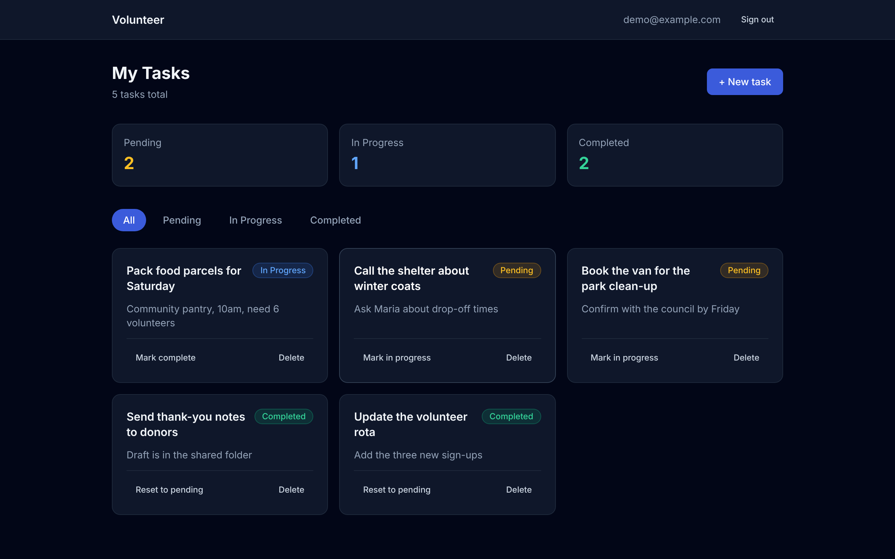
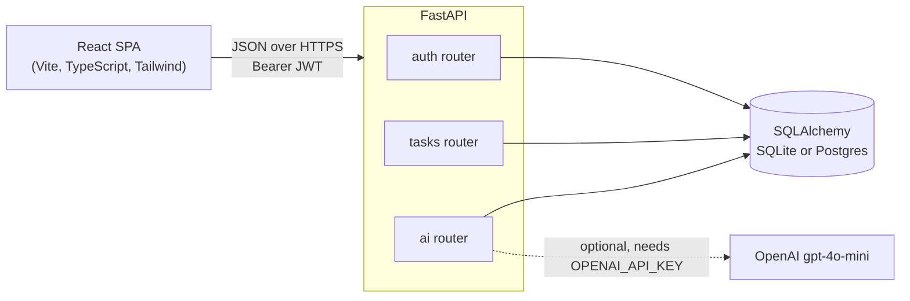

# Volunteer Task Manager

[](https://github.com/yehorm14/volunteer_api/actions/workflows/ci.yml)
[](LICENSE)


A task manager for volunteer coordinators, with optional GPT-4o-mini helpers for categorising tasks and turning notes into tasks.



## Why it is useful

- Keeps volunteer assignments in one place instead of scattered notes.
- Each account sees only its own tasks.
- Free-text notes become a structured task in one step.

## Features

- Register and log in with email and password (at least 8 characters, bcrypt hashes, JWT bearer tokens). Emails are validated and stored lower-case, so login ignores case and `A@x.com` and `a@x.com` are one account.
- Create, view, edit and delete tasks with `pending`, `in_progress` and `completed` status (the API rejects anything else; sending `description: null` clears the description).
- Dashboard with status counts, filter tabs and optimistic updates that roll back on failure.
- Ownership checks on every task route; another user's task returns 404.
- AI categorise: one-word category and short explanation for a task.
- AI extract: saves a task parsed from free-text notes using structured output.
- AI is optional: the AI features are off without `OPENAI_API_KEY`; those two endpoints return 503 and the UI shows a notice. Everything else works.
- Abuse limits: `/auth/login` and `/auth/register` allow 5 requests per minute per IP (429 after that), and each user gets 20 AI calls per UTC day across both AI endpoints (429 after that, counted in the database). Both are configurable; see `AUTH_RATE_LIMIT`, `AI_DAILY_LIMIT` and `TRUST_PROXY_HEADERS` in [docs/DEPLOY.md](docs/DEPLOY.md).

## How it works



- React app (Axios) calls a FastAPI app split into `auth`, `tasks` and `ai` routers.
- SQLAlchemy stores users and tasks in SQLite, or Postgres via `DATABASE_URL`. Alembic migrations (`backend/migrations`) build and upgrade the schema at startup; see [docs/DEPLOY.md](docs/DEPLOY.md).
- The OpenAI client is created on first use, so the API starts without a key.
- The API refuses to start if `SECRET_KEY` is missing, is the `change-me` placeholder, or is under 16 characters.

## API endpoints

Interactive docs are served at `/docs`. All task routes act only on the signed-in user's own tasks.

| Method | Path | Auth | Purpose |
| :--- | :--- | :--- | :--- |
| GET | `/` | no | Welcome message |
| POST | `/auth/register` | no | Create an account (password 8 to 72 bytes) |
| POST | `/auth/login` | no | Exchange email and password (form-encoded) for a JWT |
| GET | `/tasks` | yes | List your tasks |
| POST | `/tasks` | yes | Create a task |
| GET | `/tasks/{task_id}` | yes | Get one task |
| PATCH | `/tasks/{task_id}` | yes | Update title, description or status |
| DELETE | `/tasks/{task_id}` | yes | Delete a task |
| POST | `/tasks/{task_id}/ai-categorize` | yes | AI category and short explanation (503 without a key) |
| POST | `/tasks/extract` | yes | Create a task from free-text notes sent as JSON `{"notes": "..."}` (503 without a key) |

## Tech stack

- Backend: Python 3.13, FastAPI, SQLAlchemy, PyJWT, bcrypt, Pydantic v2
- Frontend: React 18, TypeScript, Vite, Tailwind CSS, React Router
- Data and AI: SQLite, OpenAI `gpt-4o-mini`
- Tooling: pytest, GitHub Actions

## Run locally

```bash
python3 -m venv .venv && source .venv/bin/activate
pip install -r backend/requirements-dev.txt
cp .env.example .env   # set SECRET_KEY (required); OPENAI_API_KEY is optional
uvicorn backend.main:app --reload
```

In a second terminal:

```bash
cd frontend && npm ci && npm run dev
```

Open `http://localhost:5173`. The API runs on port 8000 with docs at `/docs`. Data is stored in `backend/volunteer.db`. Environment variables and deployment are in [docs/DEPLOY.md](docs/DEPLOY.md).

### Sample workspace (read-only, optional)

A deployment can offer a "Try the sample workspace" button: visitors see the three made-up sample tasks in all three statuses without an account, real notes or AI credentials, and cannot change anything. It is off unless you set `DEMO_USER_EMAIL` and `DEMO_PUBLIC=1` on the API and build the frontend with `VITE_DEMO_ENABLED=true`; see [Public sample workspace](docs/DEPLOY.md#public-sample-workspace). No public demo URL is published yet.

### Demo account (optional)

To get a ready-made login with a few sample tasks, set both variables in `.env`:

```bash
DEMO_USER_EMAIL=demo@example.com
DEMO_USER_PASSWORD=demo-password   # at least 8 characters; use something else if the API is public
```

The user is created at startup, or on demand with `python -m backend.seed_demo`. Running it again changes nothing. Leave the variables unset to skip it.

## Tests

Backend tests (124), run with `python -m pytest` from the repo root. They use an in-memory SQLite database per test and never read `.env`. They cover:

- Auth: registration, duplicate emails, password length rules (8 characters minimum, 72 bytes maximum), login, JWT validity, rejected tokens.
- Tasks: create, list, update and delete, plus ownership checks (another user gets 404) and auth required on every route.
- AI endpoints: 503 without a key, categorise and extract with a mocked OpenAI client, refusals, retries and provider errors.
- Rate limits: the 6th login in a minute and the 21st AI call in a day answer 429, windows and UTC day rollover use a fake clock, proxy IP handling, shared and per-user quota.
- Config: `SECRET_KEY` validation, `.env` loading only from the real entry point, CORS origin parsing, database URL normalisation.
- Demo seeding: creation, idempotency and startup seeding.
- Public sample workspace: off by default, passwordless token, three statuses visible, every write and both AI endpoints answer 403, real accounts unaffected.

The migration tests run on SQLite by default; set `TEST_DATABASE_URL` (a Postgres server where the user may create databases) to run them on Postgres too. They create and drop a uniquely named database per test.

CI (`.github/workflows/ci.yml`) runs the backend tests, a Postgres job (migrations through the CLI, then `backend/tests/test_migrations.py` against a Postgres 16 service), then on the frontend `npm ci`, `npm run typecheck`, `npm test` and `npm run build`.

### Frontend tests

```bash
cd frontend && npm ci && npm test
```

Vitest, Testing Library and msw run the real app in jsdom against an in-memory fake of the API. Nothing touches a live backend, provider or database, and any request a test has not mocked fails the test. They cover sign-in, creating, status changes, filtering and deleting tasks, legacy statuses, a failed status change, delete and create (the list is restored and the user is told why), a failed load, a stale list response, and overlapping edits.

## Limitations

- The password rules are length only; there is no email verification or password reset.
- AI endpoints are tested with a mocked OpenAI client only.

## Licence

MIT. See [LICENSE](LICENSE).

## Upgrading: case-duplicate emails (migration 0004)

Migration 0004 lower-cases every stored email and adds a unique index on `lower(email)`. If an existing database holds accounts that differ only by case, the oldest one (lowest id) keeps the plain lower-cased address. Each other one is deactivated and renamed to `<local>+duplicate-<id>@<domain>`; it keeps its tasks and password, nothing is deleted, and each rename is logged as a warning during the migration. Review those accounts afterwards and merge or remove them by hand. Downgrading drops the index but does not restore the original casing.

Sign-in tokens now carry the user id (`uid` claim) and the API resolves the account by id, and rejects deactivated accounts. Tokens issued before this deploy have no `uid`, so every existing session is signed out once and users log in again. This also stops an old token for a renamed duplicate account from resolving to the surviving account.

Note: the `compare_metadata` check in `backend/tests/test_migrations.py` only compares the `lower(email)` expression index meaningfully on Postgres (SQLite reflection skips expression indexes), so rely on the Postgres CI job for it.
