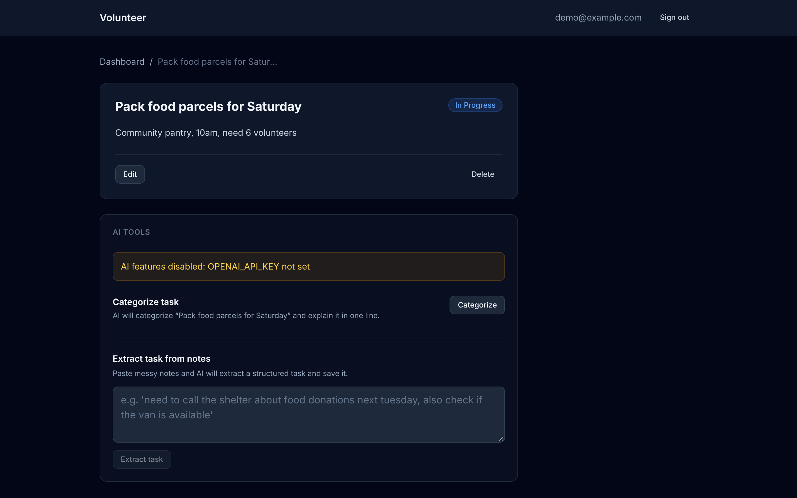

# Volunteer Task Manager

A task manager for volunteer assignments, with a FastAPI backend, a React frontend and two optional GPT-4o-mini helpers.


**Live demo:** coming soon

## Why it is useful

- Volunteer coordinators track who needs to do what in one place instead of scattered notes.
- Each account sees only its own tasks.
- Messy notes ("call the shelter about coats next Tuesday") can be turned into a task in one step.

## Features

- Register and log in with email and password. Passwords are hashed with bcrypt. Sessions use JWT bearer tokens.
- Create, list, view, edit (partial update) and delete tasks. Status is `pending`, `in_progress` or `completed`.
- Dashboard with status counts, filter tabs, and optimistic updates that roll back on failure.
- Ownership checks on every task route. Another user's task returns 404.
- AI categorise: returns a one-word category and a short explanation for a task.
- AI extract: turns free-text notes into a saved task using OpenAI structured output.
- AI is optional. Without `OPENAI_API_KEY` the two AI endpoints return 503 and the UI shows "AI features disabled: OPENAI_API_KEY not set".
- Interactive API docs at `/docs`.



## How it works

- The React app (Vite, TypeScript, Tailwind) calls the API with Axios. A request interceptor adds the JWT; a 401 clears it and redirects to the login page.
- In development, Vite proxies `/api` to `localhost:8000`. In production, `VITE_API_URL` sets the API base URL.
- The FastAPI app is split into three routers: `auth`, `tasks` and `ai` (`backend/routers/`). Paths are `/auth/*`, `/tasks/*`.
- SQLAlchemy stores users and tasks in SQLite. Tables are created on startup.
- The OpenAI client is created on first use, so the API starts without a key.

## Tech stack

- Backend: Python 3.13, FastAPI, SQLAlchemy, SQLite, python-jose (JWT), bcrypt, Pydantic v2
- AI: OpenAI Python SDK, `gpt-4o-mini`
- Frontend: React 18, TypeScript, Vite, Tailwind CSS, React Router, Axios
- Tests and CI: pytest, GitHub Actions
- Deploy configs: `render.yaml` (API), `frontend/vercel.json` (frontend)

## Run locally

Backend (from the repo root):

```bash
python3 -m venv .venv && source .venv/bin/activate
pip install -r backend/requirements-dev.txt
cp .env.example .env
# edit .env: set SECRET_KEY (required); OPENAI_API_KEY is optional
uvicorn backend.main:app --reload
```

Generate a secret key with `python -c "import secrets; print(secrets.token_urlsafe(32))"`. The API starts on `http://127.0.0.1:8000`.

Frontend (second terminal):

```bash
cd frontend
npm ci
npm run dev
```

Open `http://localhost:5173`.

Environment variables (see `.env.example`):

| Variable | Required | Default |
| :--- | :--- | :--- |
| `SECRET_KEY` | yes | none; the API refuses to start without it |
| `OPENAI_API_KEY` | no | AI endpoints return 503 |
| `DATABASE_URL` | no | SQLite file at `backend/volunteer.db` |
| `CORS_ORIGINS` | no | local dev origins (`localhost:5173`, `localhost:3000`) |
| `VITE_API_URL` | no (frontend) | `/api` (Vite proxy) |

## Tests

25 tests: `python -m pytest` from the repo root. They cover registration, login and tokens, auth on every protected route, task CRUD, ownership isolation, the 503 response without a key, and the AI endpoints with a mocked OpenAI client. Tests use an in-memory SQLite database.

The frontend check is `cd frontend && npm run build` (type-checks, then builds). CI runs both.

## Deploy

- API on Render: `render.yaml` defines the service. Set `CORS_ORIGINS` to the frontend URL; `SECRET_KEY` is generated.
- Frontend on Vercel: set the project root to `frontend` and add `VITE_API_URL` with the API URL. `vercel.json` rewrites all routes to `index.html`.

## Limitations and next steps

- SQLite on Render's free tier is ephemeral. Use a persistent `DATABASE_URL` to keep data.
- No database migrations; tables are created with `create_all`.
- The AI endpoints have not been run against the live OpenAI API in the test suite; they are tested with a mock.
- No frontend tests or linter yet.

## Licence

MIT. See [LICENSE](LICENSE).
