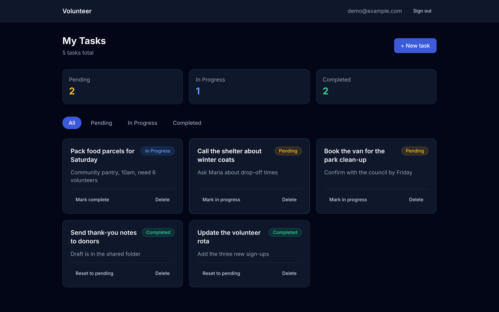
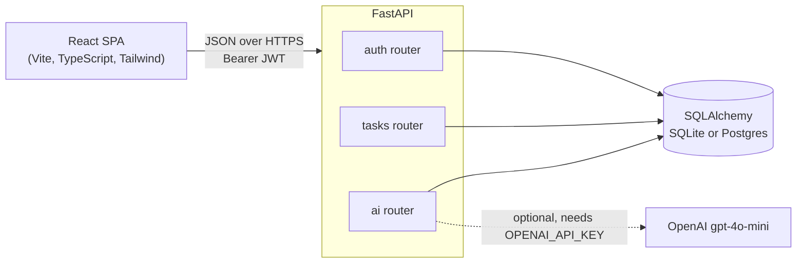

# Volunteer Task Manager

[](https://github.com/yehorm14/volunteer-task-manager/actions/workflows/ci.yml)
[](LICENSE)


A task manager for volunteer coordinators, with optional GPT-4o-mini helpers for categorising tasks and turning notes into tasks.



## Why it is useful

- Keeps volunteer assignments in one place instead of scattered notes.
- Each account sees only its own tasks.
- Free-text notes become a structured task in one step.

## Features

- Register and log in with email and password (at least 8 characters, bcrypt hashes, JWT bearer tokens).
- Create, view, edit and delete tasks with `pending`, `in_progress` and `completed` status.
- Dashboard with status counts, filter tabs and optimistic updates that roll back on failure.
- Ownership checks on every task route; another user's task returns 404.
- AI categorise: one-word category and short explanation for a task.
- AI extract: saves a task parsed from free-text notes using structured output.
- AI is optional: the AI features are off without `OPENAI_API_KEY`; those two endpoints return 503 and the UI shows a notice. Everything else works.

## How it works



- React app (Axios) calls a FastAPI app split into `auth`, `tasks` and `ai` routers.
- SQLAlchemy stores users and tasks in SQLite, or Postgres via `DATABASE_URL`.
- The OpenAI client is created on first use, so the API starts without a key.
- The API refuses to start if `SECRET_KEY` is missing, is the `change-me` placeholder, or is under 16 characters.

## API endpoints

Interactive docs are served at `/docs`. All task routes act only on the signed-in user's own tasks.

| Method | Path | Auth | Purpose |
| :--- | :--- | :--- | :--- |
| GET | `/` | no | Welcome message |
| POST | `/auth/register` | no | Create an account (password 8 to 72 bytes) |
| POST | `/auth/login` | no | Exchange email and password (form-encoded) for a JWT |
| GET | `/tasks` | yes | List your tasks |
| POST | `/tasks` | yes | Create a task |
| GET | `/tasks/{task_id}` | yes | Get one task |
| PATCH | `/tasks/{task_id}` | yes | Update title, description or status |
| DELETE | `/tasks/{task_id}` | yes | Delete a task |
| POST | `/tasks/{task_id}/ai-categorize` | yes | AI category and short explanation (503 without a key) |
| POST | `/tasks/extract` | yes | Create a task from free-text notes sent as JSON `{"notes": "..."}` (503 without a key) |

## Tech stack

- Backend: Python 3.13, FastAPI, SQLAlchemy, PyJWT, bcrypt, Pydantic v2
- Frontend: React 18, TypeScript, Vite, Tailwind CSS, React Router
- Data and AI: SQLite, OpenAI `gpt-4o-mini`
- Tooling: pytest, GitHub Actions

## Run locally

```bash
python3 -m venv .venv && source .venv/bin/activate
pip install -r backend/requirements-dev.txt
cp .env.example .env   # set SECRET_KEY (required); OPENAI_API_KEY is optional
uvicorn backend.main:app --reload
```

In a second terminal:

```bash
cd frontend && npm ci && npm run dev
```

Open `http://localhost:5173`. The API runs on port 8000 with docs at `/docs`. Data is stored in `backend/volunteer.db`. Environment variables and deployment are in [docs/DEPLOY.md](docs/DEPLOY.md).

### Demo account (optional)

To get a ready-made login with a few sample tasks, set both variables in `.env`:

```bash
DEMO_USER_EMAIL=demo@example.com
DEMO_USER_PASSWORD=demo-password   # at least 8 characters; use something else if the API is public
```

The user is created at startup, or on demand with `python -m backend.seed_demo`. Running it again changes nothing. Leave the variables unset to skip it.

## Tests

56 backend tests, run with `python -m pytest` from the repo root. They use an in-memory SQLite database per test and never read `.env`. They cover:

- Auth: registration, duplicate emails, password length rules (8 characters minimum, 72 bytes maximum), login, JWT validity, rejected tokens.
- Tasks: create, list, update and delete, plus ownership checks (another user gets 404) and auth required on every route.
- AI endpoints: 503 without a key, categorise and extract with a mocked OpenAI client, refusals, retries and provider errors.
- Config: `SECRET_KEY` validation, `.env` loading only from the real entry point, CORS origin parsing, database URL normalisation.
- Demo seeding: creation, idempotency and startup seeding.

CI (`.github/workflows/ci.yml`) runs the backend tests, then on the frontend `npm ci`, `npm run typecheck` and `npm run build`. There are no frontend unit tests.

## Limitations

- No migrations (tables are created at startup) and no frontend tests.
- The password rules are length only; there is no email verification or password reset.
- AI endpoints are tested with a mocked OpenAI client only.

## Licence

MIT. See [LICENSE](LICENSE).
